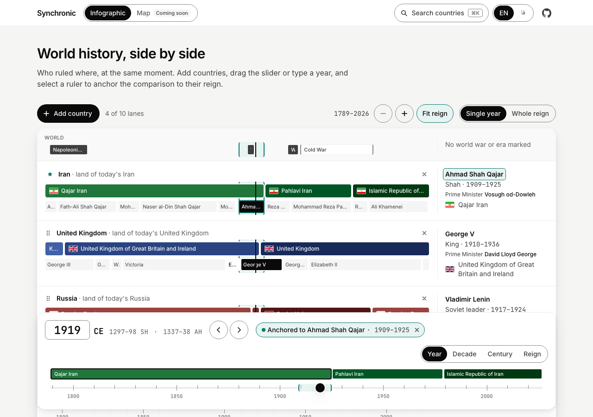
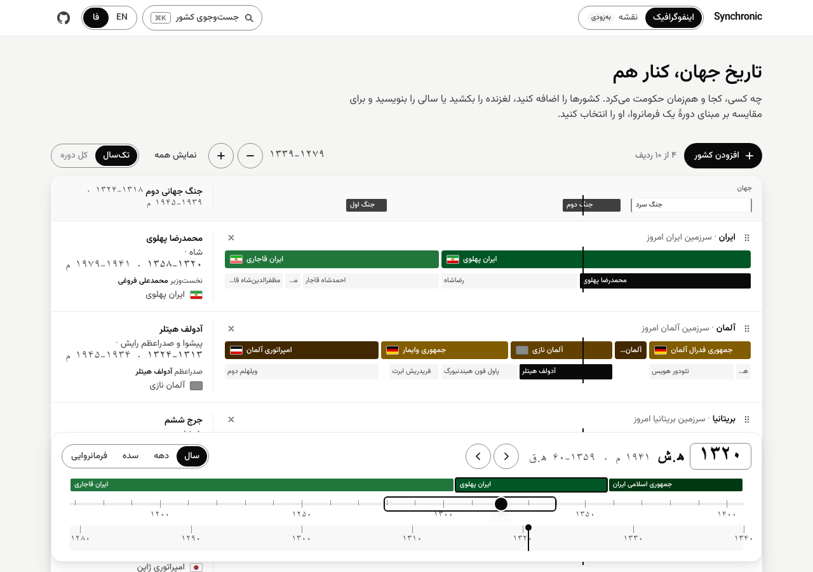
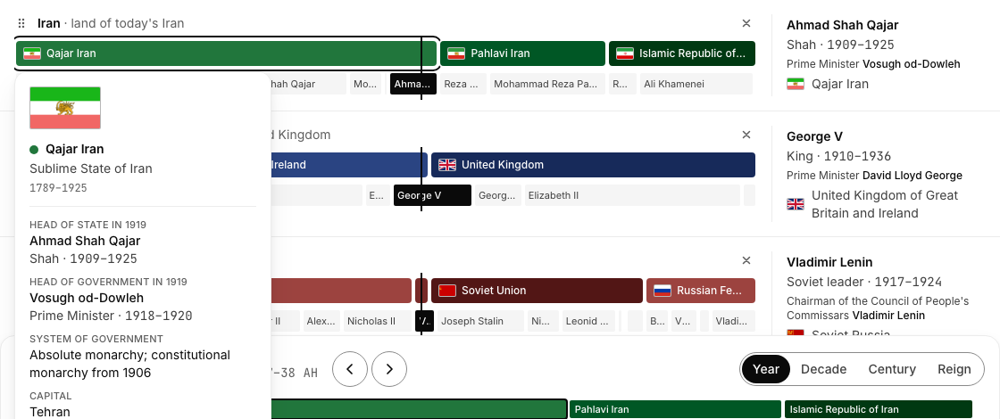
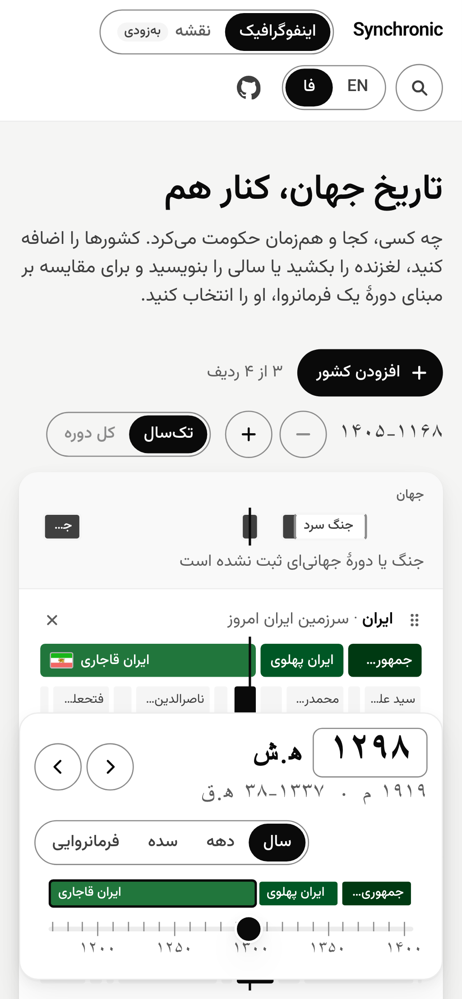

# Synchronic

**World history, side by side.** An open-source, bilingual (English and Persian) web app that shows who ruled where, and what was happening, across the world at the same moment.

> Status: **MVP in progress** — the infographic view works for nine countries (Iran, UK, Russia, Turkey, France, Germany, China, India, Japan) from 1789 to today, with a time dock, anchoring, an add-country search dialog and shareable URLs. Each state has a politics card and historical flags from Wikimedia Commons, served from this site. Heads of government come from Wikidata, with curated fixes.

## Screenshots



| Persian, right to left, zoomed to 1900–1960 | The politics card | On a phone |
| --- | --- | --- |
|  |  |  |

## Run it

Requires Node 22+ and pnpm 9.

```bash
pnpm install
pnpm dev
```

Open <http://localhost:3000> — it redirects to `/en`; Persian (right-to-left) is at `/fa`.

| Command | What it does |
| --- | --- |
| `pnpm dev` | Start the dev server |
| `pnpm build` | Static production build for both locales |
| `pnpm typecheck` | Generate route types and run `tsc` |
| `pnpm lint` | ESLint |
| `pnpm test` | Vitest (schema, lane validation, calendars) |
| `pnpm test:e2e` | Playwright flows and axe accessibility checks; run `pnpm build` first (first time: `pnpm exec playwright install chromium`) |
| `pnpm data:audit` | Cross-check terms and Persian names against Wikidata and fetch every source URL; writes problems to `artifacts/data-review/` |
| `pnpm data:build` | Validate the data and emit one content-hashed file per country to `public/data/` (runs before `dev`, `build` and `typecheck`) |
| `pnpm data:validate` | Validate every file in `data/overrides/countries/` |
| `pnpm fetch:flags` | Fetch flag candidates and licences from Wikidata and Commons into `data/raw/` |
| `pnpm mirror:flags` | Download the flags the data uses into `public/flags/` (the site serves them itself; withheld flags are skipped) |
| `pnpm fetch:hog` | Fetch head-of-government terms from Wikidata into `data/raw/` |
| `pnpm merge:hog` | Merge them, with the curated fixes in `data/overrides/`, into the country files |
| `pnpm spike:iran` | Fetch Iran's heads of state from Wikidata into `data/raw/` |

## Layout

```
data/overrides/countries/   Curated country files (states, lane, people, terms)
data/policy/                Content-policy lists (withheld symbols)
data/raw/                   Cached Wikidata responses
messages/                   UI strings: en.json, fa.json
scripts/                    Data pipeline scripts
src/app/[locale]/           Pages; the locale is a root param
src/i18n/                   next-intl routing and request config
src/lib/data/               Zod schemas, validation, queries
src/lib/calendar.ts         Gregorian / Solar Hijri / Lunar Hijri years
```

## Data rules in one minute

- Years are integers; BCE is negative; there is no year 0.
- Ranges are half-open (`start ≤ year < end`); `end: null` means "still current".
- Every record has `sources[]`, and every label exists in English **and** Persian — a missing Persian label fails validation rather than falling back.
- An office term may have `start` equal to `end`: it began and ended within that year (Edward VIII, 1936).
- `office: "leader"` marks a de facto ruler outside the formal offices (Soviet general secretaries, China's paramount leaders); the lane shows these instead of the head of state.
- A lane has no gaps or overlaps. Parallel governments are `kind: "rival"`; periods without a state are `kind: "no-state"` with a note.

See [CONTRIBUTING.md](docs/CONTRIBUTING.md) for the full guide.

## Found a mistake?

History data is never finished. If a date, name, ruler or flag is wrong:

1. Report a [data error](https://github.com/hashemi42/Synchronic/issues/new?template=data-error.yml) with a source, or
2. Fix it yourself in `data/overrides/countries/<country>.json` and open a pull request; [CONTRIBUTING](docs/CONTRIBUTING.md) explains the format.

Disputed history follows the [content policy](docs/CONTRIBUTING.md#content-policy). Wording or Persian names go in the [translation form](https://github.com/hashemi42/Synchronic/issues/new?template=translation.yml). Bugs go in the [bug form](https://github.com/hashemi42/Synchronic/issues/new?template=bug.yml); security problems are reported privately, see [SECURITY](docs/SECURITY.md). Everyone taking part follows the [code of conduct](docs/CODE_OF_CONDUCT.md).

## Known limitations

- **Search finds countries, not people.** It matches country names, aliases, states and capitals (with spelling variants such as Qajar/Ghajar and Tehran/Teheran), but not rulers. Searching "Victoria" finds nothing.
- **The "+1" badge sits in a lane's right column**, not on the lane itself. It counts rival governments at the selected year and opens them in place.
- **Real-device touch testing is still pending.** Taps are tested with Playwright's phone emulation (Pixel 7) only.
- **Pinch zoom and touch drag-to-reorder need a physical device.** Both are implemented and keyboard-equivalents are tested, but neither has been tried on real hardware.
- **The detail track has no event dots.** The data has no events yet (the schema exists), so it shows ticks, the cursor and the anchor's reign only.
- **Phones shorter than 704 px (44rem) hide the era strip and detail track** to keep the floating dock compact. The lanes' own axis and the slider cover the same ground.
- **Persian years are Solar Hijri, one per Gregorian year.** A Gregorian year spans two Solar Hijri years; the UI uses the one in force on 1 July (Gregorian − 621). Dates in the data and URLs stay Gregorian.

## Licences

Code is [MIT](LICENSE). Data is licensed separately — curated data is CC BY-SA 4.0, Wikidata-derived data is CC0; see [DATA_LICENSE](DATA_LICENSE).
